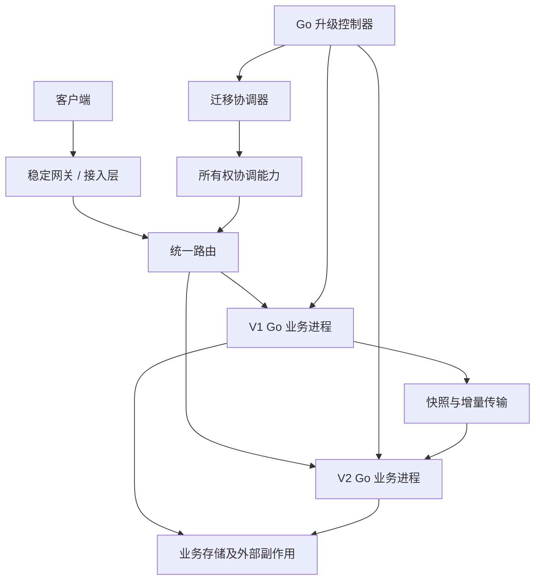
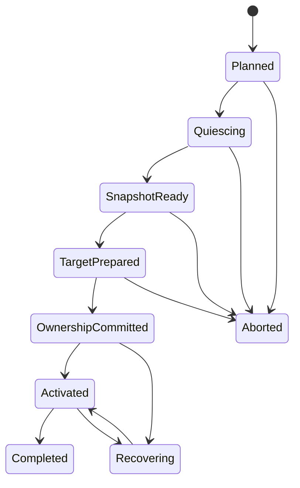

# 原生 Go 在线升级与状态迁移设计

- 日期：2026-10-30
- 状态：待评审草案，未批准实施
- 关联：[统一路由与可插拔目录设计](DESIGN_UNIFIED_ROUTING.md)
- 适用范围：Go 业务服务的版本共存、滚动替换、有状态实体交接及失败恢复
- 实现状态：本文为方案设计，不代表框架已有升级控制器、迁移协议或所有权隔离能力。

## 1. 结论与“热更”的定义

推荐采用 **稳定接入 + V1/V2 Go 进程共存 + 版本化路由 + 显式状态交接**。

这里的热更是“业务在线升级”：新旧二进制可以同时运行，通过逐步排空或迁移切换业务，不是在运行中的 Go 进程中任意替换函数、类型或对象布局。

用户业务和升级组件均可以使用 Go 实现，无需脚本语言。发布、进程启动、制品分发可以由 Go 控制器或已有部署平台完成，不要求使用 shell 脚本。

需明确三个独立目标：

1. **服务整体不中断**：升级期间仍有实例提供服务。
2. **客户端连接尽量不断开**：业务进程切换不影响稳定网关持有的连接。
3. **单个实体状态连续**：玩家迁移后状态及已确认操作不丢失、不重复执行。

三者需要不同机制。系统整体可用不代表某个玩家完全没有短暂停顿；保持连接也不等于每条请求恰好执行一次。

## 2. 背景与约束

- 框架和业务使用原生 Go，不引入脚本运行时。
- 玩家按实时负载和业务条件动态放置，不绑定固定业务节点。
- 玩家可能频繁切换场景，位置缓存不能作为唯一权威。
- 基础设施可插拔，不要求 etcd 或 Redis。
- 现有 RPC 应尽量复用，但需要补充路由版本、迁移状态及错误语义。
- 路由管理规模需要通过分片扩展，不能对全部节点广播每次玩家位置变化。

本文沿用统一路由文档中的目标模型和所有权契约。业务实例在哪里运行，与该玩家的目录记录由哪个路由分片管理，是两个独立问题。

## 3. 技术路线比较

| 路线 | 特点 | 结论 |
|---|---|---|
| 新旧 Go 进程共存 | 隔离清晰，跨平台，可独立启动验证和回收 | 推荐 |
| Go plugin | 平台支持受限，依赖构建一致性要求高，不能卸载插件，也不自动迁移旧对象 | 不作为框架通用升级基础 |
| 运行时代码补丁 | 涉及指令修改、内联、栈及运行时约束，难以保证任意业务安全 | 不采用 |
| 仅滚动重启 | 实现简单，适合无状态或可重建状态的服务 | 作为基础升级模式 |
| 脚本热更新 | 不符合全 Go 要求 | 排除 |

Go 标准工具链不提供一般意义上安全替换任意运行中业务代码的能力。不要以“替换函数地址”代替状态、并发任务和兼容性设计。

## 4. 总体架构

### 4.1 组件职责

| 组件 | 职责 |
|---|---|
| 升级控制器 | 发布批次、启动新版本、健康门禁、排空策略、暂停和清理 |
| 调度器 | 根据负载、容量及协议/状态兼容性选择目标实例 |
| 统一路由 | 将服务或实体逻辑身份解析到当前目标 |
| 所有权协调器 | 条件提交实体所有权，保证代次交接和旧写入者隔离 |
| 迁移协调器 | 驱动单实体迁移状态机，记录进度并恢复中断操作 |
| 业务迁移适配器 | 停写、排空、快照、恢复、校验及激活 |
| 网关 | 维持客户端连接、请求标识、流控及必要的有界等待 |
| 存储写入端 | 校验有效所有权，阻止旧进程的迟到写入 |

这些是职责划分，不要求每项部署独立进程。早期控制器和迁移协调器可以部署在同一 Go 服务中，但状态应可恢复。

### 4.2 Bootstrap

控制器和路由服务的初始地址由配置、种子地址或已有部署系统提供，不能依赖业务服务先完成发现才能启动升级控制面。

稳定网关也需要升级，但其连接迁移是独立问题。可采用网关滚动排空及客户端重连协议，不宣称任意 TCP/WebSocket 连接可以直接搬到另一个 Go 进程。

## 5. 身份与版本模型

| 字段 | 用途 |
|---|---|
| LogicalID | 玩家、房间或服务的逻辑身份 |
| InstanceID | 某个具体业务实例身份 |
| Incarnation | 区分同一实例重启前后的进程 |
| DeploymentVersion | V1/V2 等代码制品版本 |
| ProtocolVersion | 请求响应兼容版本 |
| StateSchemaVersion | 快照及持久化状态的格式版本 |
| OwnershipEpoch | 隔离该实体旧所有者的代次 |
| RouteRecordVersion | 路由记录条件更新与缓存新旧比较 |
| MigrationID | 一次迁移的全局唯一操作标识 |
| ReleaseID | 一次发布批次的标识 |

不能用 DeploymentVersion 代替 OwnershipEpoch。同一版本也可能发生多次迁移；同一实体也可能回迁到旧代码但必须获得新的所有权代次。

客户端通常不需要选择 V1 或 V2。调用者使用逻辑目标，路由返回当前实例及必要代次，目标进程执行对应二进制。

协议不兼容时需要协商、网关转换或按客户端能力分流，不能假定路由切换能解决序列化兼容问题。

## 6. 三种升级模式

### 6.1 无状态滚动替换

1. 启动 V2 并检查健康及协议兼容性。
2. V2 发布 Ready，按灰度策略接收请求。
3. V1 标记 Draining，停止接收新工作。
4. 等待在途请求完成，在超时策略下退出。

重试仍需区分幂等请求与结果未知的写操作。

### 6.2 有状态自然排空：推荐首期

1. 新登录或新建实体只分配到 V2。
2. V1 继续服务已有实体。
3. 实体正常退出后释放所有权。
4. V1 实体数归零后停止进程。

优点是迁移风险低、业务改造较少。缺点是长连接玩家或长生命周期房间可能长期不退出，发布耗时没有严格上界。

重连不是“新建实体”的同义词：调度前必须检查现有所有权，避免连接重试在 V2 创建第二个玩家。

### 6.3 有状态主动迁移

对需要限时完成升级或回收节点的实体执行显式交接。业务必须提供可序列化状态、停写边界、恢复逻辑以及副作用治理。

推荐先实现短暂停写快照迁移；增量预复制可以降低停顿，但显著增加一致性复杂度，应作为后续优化。

## 7. 必须成立的安全不变量

1. 对每个实体，同一时刻至多有一个被写入端认可的权威写入者。
2. 新所有者不能在所有权提交和隔离建立之前处理权威写入。
3. 已向调用者确认成功的操作，其效果必须进入可恢复状态或可重放的持久记录。
4. 迁移失败或超时不允许无条件恢复旧快照。
5. 路由记录删除重建不能使旧所有权代次重新有效。
6. 所有重试、恢复和控制器接管都以 MigrationID 和条件版本推进，避免重复激活。
7. 路由更新、快照传输和数据库写入不是一个天然原子事务。

如果后端无法提供所需条件更新、持久化和隔离保证，应拒绝启用安全主动迁移，而不是降级成“加一个分布式锁”。

## 8. 迁移单元

默认单元可以是玩家、房间或具有独立权威状态的 Actor，但不能仅凭 ID 拆分业务一致性边界。

若多个 Actor 共享不可拆分内存状态，或一次操作要求同进程原子更新，应选择以下之一：

- 将它们作为同一迁移单元。
- 将共享状态移到明确协调的服务或事务存储。
- 定义跨实体事务/补偿协议后再独立迁移。

涉及大量玩家的场景迁移可能是多个迁移操作组成的工作流，不等于全场景原子切换。

## 9. 主动迁移协议

### 9.1 持久迁移记录

至少记录：MigrationID、实体 Key、源/目标实例及 incarnation、旧/候选所有权代次、阶段、阶段版本、快照位置及摘要、截止时间、失败信息、提交结果。

快照一般存放在受控传输通道或独立对象存储中；协调记录保存引用和校验摘要，不保存大型业务对象。

协调阶段变更需条件更新。控制器租约只能决定谁驱动流程，不能替代业务所有权隔离。

### 9.2 建议状态机

Aborted 只允许在确认所有权尚未提交且目标未激活时发生。提交后的故障属于恢复或新一次迁移，不能走旧式 Abort。

### 9.3 逐步执行

**步骤 1：计划与占位**

- 读取当前所有者和记录版本。
- 选择支持状态格式及协议的目标 V2，并预留容量。
- 以条件更新建立迁移记录，阻止同一实体并发迁移或重复创建。

**步骤 2：停止新写入并排空**

- 源实例进入 Quiescing，拒绝新的权威写请求，或由入口短期等待。
- 等待在途业务操作、邮箱任务及已启动副作用进入明确完成点。
- 暂停定时器和后台任务，不再派生新的权威操作。
- 对无法排空的任务按业务策略取消、等待或中止迁移，不强行快照后继续写。

**步骤 3：导出快照**

- 在已定义的一致性边界导出业务状态。
- 包含去重/序列进度及必要定时任务元数据。
- 写入快照头、大小、schema 版本和摘要。
- 快照持久化或确认可恢复后，记录 SnapshotReady。

**步骤 4：目标准备**

- 目标验证来源、摘要、格式和容量。
- 转换旧 schema，恢复内存状态，检查业务不变量。
- 保持被动状态：不启动权威定时任务，不处理写请求，不产生外部副作用。
- 记录 TargetPrepared。

**步骤 5：提交所有权及建立隔离**

- 使用旧记录版本、源 incarnation 和 MigrationID 条件提交新所有者及新代次。
- 确认业务写入端已拒绝旧代次，并允许新所有者。
- 该步骤可能涉及多个系统；必须可恢复，在无法确认时暂停实体而不是同时激活两边。
- 状态为 OwnershipCommitted，并保留可恢复的快照引用。

**步骤 6：激活目标**

- 目标验证权威提交结果，幂等激活。
- 恢复定时任务、接收请求并发布可调用状态。
- 路由缓存通过刷新、订阅或陈旧路由响应收敛。

**步骤 7：清理源**

- 源不再拥有写权限，短期保留迁移结果供查证或返回 StaleRoute。
- 确认目标运行稳定后回收旧实体状态。
- 按保留策略清理快照，记录 Completed。

### 9.4 隔离机制的实际边界

单纯提交更大的 fencing token，并不会让所有外部系统自动知道旧 token 已失效。

对于数据库，应在目标开始写之前，通过事务更新权威代次，并要求每次写入在同一事务中检查该代次；或者使用能同步验证当前所有权的等价机制。只在“偶然看到更大 token 后”拒绝旧 token，可能留下交接窗口。

对于无法校验代次的支付、消息、邮件等系统，应通过受控副作用服务、幂等键、outbox 或业务补偿建立安全边界。不能承诺对任意外部接口提供通用恰好一次执行。

## 10. 迁移期间的请求处理

### 10.1 请求元信息

跨迁移的请求建议携带：逻辑目标、请求 ID、可选会话序列、调用截止时间，以及解析得到的所有权代次。

请求 ID 在重试时保持不变。请求序列只在其声明的会话或实体范围内有序，不能推导全局顺序。

### 10.2 有界等待与背压

迁移期间可选择：

- 返回可重试的 Migrating/Unavailable。
- 在网关或指定入口短期排队，等待目标激活。

队列必须同时限制实体维度和全局维度的数量、字节及等待时间。队列满时显式拒绝，不能无限堆积。

内存队列丢失不能影响已经确认的写入；若网关收到请求后就向客户端确认接受，则必须明确接受确认不等于业务成功，或提供持久化队列。

### 10.3 陈旧路由

旧实例返回 StaleRoute 或受控重定向。调用方刷新后在剩余 deadline 内有限重试，设置最大跳数以避免循环。

不推荐源实例无限转发到目标：连续迁移会形成转发链，也会掩盖连接和权限问题。短期转发如启用必须有上限，并保留请求 ID。

### 10.4 去重与顺序

需要将已完成请求的去重窗口或结果索引纳入可恢复状态。仅在旧进程内存保存去重集合，迁移后会失效。

对于必须保持顺序的业务，目标恢复最后已提交序列，检查缺口和重复；请求乱序是否等待、拒绝或补发由业务协议定义。

## 11. 快照与业务适配契约

不建议框架自动序列化任意 Go 对象图。goroutine、channel、mutex、连接、闭包及指针地址不可直接作为可迁移业务状态。

框架提供生命周期钩子的语义，业务实现显式 DTO 和转换：

| 阶段能力 | 语义 |
|---|---|
| Quiesce | 停止接收新权威操作 |
| Drain | 等待已接受任务达到安全边界 |
| Snapshot | 导出一致快照及进度 |
| Restore | 恢复状态但不产生副作用 |
| Validate | 检查 schema、业务不变量及依赖 |
| Activate | 在验证新所有权后幂等启动 |
| AbortPrepare | 提交前清理目标准备状态 |
| ResumeSource | 确认仍持有有效所有权后恢复源处理 |
| Retire | 回收失去所有权的源状态 |

具体 Go 签名在实施前结合现有 Actor/Service 生命周期定稿。所有远程或阻塞步骤接受 context；超时不意味着已经取消外部副作用。

### 11.1 快照内容

- 格式版本、实体身份、MigrationID、源代次。
- 业务数据及必要关联关系。
- 已提交请求序列和去重信息。
- 定时任务的逻辑定义、到期时间及触发策略。
- 对持久化状态的版本引用。
- 数据摘要、长度和可选压缩信息。

快照与持久化数据库之间必须明确谁是权威：不能一边导出内存旧状态，一边让异步数据库写继续推进而没有一致性边界。

### 11.2 定时器和异步任务

保存逻辑任务，不复制运行中的 goroutine。目标激活后重建任务。

跨停顿期间到期任务需要业务指定策略：执行一次、跳过、按周期补偿或合并执行。定时触发的副作用同样需要去重和所有权检查。

## 12. 兼容性设计

### 12.1 RPC 协议

升级期间至少允许计划共存的版本互通。新增字段优先保持向后兼容；字段语义变更需要新协议版本或显式转换。

发布控制器在放量前校验兼容矩阵，不把健康检查成功等同于业务兼容。

### 12.2 状态格式

V2 应明确支持哪些源 schema。快照转换必须可测试，不得依赖未导出的 Go 内存布局。

V2 能读取 V1 快照不代表 V1 能读取 V2 快照。反向迁移能力必须单独声明。

### 12.3 数据库变更

推荐 expand/contract：先增加兼容结构，再升级读写逻辑，最后在旧版本退出和回退窗口结束后删除旧字段。

不可逆数据变更发生后，回退策略可能只能是修复后前滚或经过验证的数据逆转换，不能仅切换二进制版本。

## 13. 失败恢复与回退

| 故障位置 | 处理原则 |
|---|---|
| V2 启动或健康检查失败 | 不放量，保留 V1 |
| 源停写前失败 | 按原所有权继续运行或执行故障恢复 |
| 排空超时 | 不生成不一致快照；中止或等待 |
| 快照/恢复失败，所有权未提交 | 验证原所有权仍有效后恢复源；清理目标 |
| 提交请求超时 | 按 MigrationID 查询结果，禁止假定提交失败 |
| 所有权已提交，目标尚未激活 | 从持久记录继续隔离和激活；禁止直接恢复旧所有者 |
| 目标激活后崩溃 | 通过持久状态、日志或业务恢复机制接管，必要时产生新代次 |
| 控制器崩溃 | 新控制器读迁移记录，条件推进，避免重复激活 |
| 旧进程失联但仍运行 | 依靠租约约束及写入端 fencing，而不是依靠路由广播 |
| 路由不可用 | 遵守一致性与缓存使用策略，禁止临时绕过所有权 |

快照迁移解决交接，不自动解决激活后的所有数据持久性。V2 激活后若只有内存状态且节点故障，最近写入可能无法恢复；业务必须明确持久化或复制策略及 RPO。

### 13.1 回退分界

**提交前**：在确认原所有权及源状态安全时，可以取消迁移并恢复 V1。

**提交后、V2 尚未处理新写入**：仍应执行受控交接，不能无条件倒改路由。可复用一致快照，但必须重新确认代次和写入隔离。

**V2 已处理新写入**：回到 V1 是一次新的迁移，需要将最新状态转换为 V1 可读格式，并获得新的所有权代次。若不支持逆转换，应停止放量并修复前滚。

## 14. 发布控制与容量

### 14.1 建议发布流程

1. 制品校验、版本登记及兼容检查。
2. 启动少量 V2，完成依赖、RPC 和状态恢复探测。
3. 先接新实体或明确的灰度范围。
4. 检查错误率、尾延迟、状态转换失败及业务指标。
5. 按批次排空或迁移 V1 实体。
6. 达到门禁阈值时自动暂停新增迁移，不盲目回滚已提交实体。
7. 确认 V1 无权威实体、无在途任务后退出。

灰度可以按玩家逻辑 ID 选择发布批次，但不等于将玩家固定在某个业务节点。

### 14.2 容量约束

新旧版本共存需要额外内存、CPU、连接和快照带宽。目标预留容量不能只依据迁移开始时的一次负载读数，应有有效期及并发配额。

迁移限流至少包含：全局、源节点、目标节点、目录分片及快照存储维度。

### 14.3 停顿预算

在停写快照模式下，可近似拆分：

$$
T_{pause} = T_{drain} + T_{snapshot} + T_{transfer} + T_{restore} + T_{commit} + T_{activate}
$$

具体阶段可以重叠，但不能在未测量前承诺零停顿。排空长任务和大状态传输通常决定上限。

增量预复制可把大部分数据传输移到停写前，但仍需最终增量边界、顺序、日志保留和截断协议；首期不默认引入。

## 15. 与现有框架的集成边界

相关入口包括 [Node](../../engine/pkg/node/node.go)、[Cluster](../../engine/pkg/cluster/cluster.go)、[Router](../../engine/pkg/router/selector.go) 和 [EndpointManager](../../engine/pkg/cluster/endpoints/endpoints.go)。以下是拟议职责，不表示已核查全部调用链。

- Node：注入升级/迁移能力，协调启动关闭，不直接依赖特定后端。
- Cluster：消费中立实例生命周期和目录信息。
- Router：按逻辑实体寻址，携带版本，表达 Migrating/StaleRoute 等错误。
- RPC：传播请求 ID、deadline 和所有权信息，提供受控重试。
- Service/Actor：增加明确的停写、排空和恢复边界，保持本地投递语义。
- 定时任务和后台任务：可停止、可重建，并校验所有权。
- 存储适配：提供条件写入、幂等或外部副作用隔离能力。

统一路由接口解耦可以独立实施；完整主动迁移依赖其所有权能力及业务适配，不宜混为一次大规模改造。

本文未修改代码。实施时需重新检查当前源码、调用链和符号影响范围。

## 16. 安全与审计

- 发布制品必须验证来源、摘要和授权。
- 迁移命令按服务及实体范围授权，普通调用者不能变更所有权。
- 快照传输加密并限制访问；包含敏感状态时加密存储。
- 限制快照大小、解压大小及恢复资源，拒绝不兼容或损坏数据。
- 每个阶段记录 ReleaseID、MigrationID、实体范围、源目标、版本及结果。
- 不将凭据、完整玩家状态输出到普通日志。
- 快照保留期、清理和恢复权限需要显式配置。

## 17. 可观测性

至少收集：

- 各版本 Ready、Draining 实例数及权威实体数。
- 迁移各阶段耗时、暂停时间、成功率、重试和中止次数。
- 排空任务数、队列深度、超时与拒绝数量。
- 快照字节、传输吞吐、校验及 schema 转换失败。
- 所有权提交冲突、写入隔离拒绝、旧路由比例。
- 控制器恢复次数、长期未完成迁移及残留状态。
- 升级前后业务错误率、P95/P99 延迟和关键业务指标。

实体 ID 用于追踪日志，不直接作为高基数指标标签。

## 18. 测试与验收

### 18.1 基础兼容测试

- V1/V2 RPC 兼容矩阵。
- 不同 schema 快照恢复及不支持版本的明确拒绝。
- 本地调用、跨节点调用、状态和可见性保持。
- 无 etcd 环境的升级控制及寻址样例。

### 18.2 迁移安全测试

- 在每个状态转换前后注入进程崩溃、超时及网络分区。
- 同一实体并发迁移、重复登录及重复控制指令。
- 快照传输中断、损坏、重复恢复和重复激活。
- 旧源在所有权提交后继续执行迟到数据库写，必须被拒绝。
- 请求执行成功但响应丢失，重试不得重复产生业务效果。
- 旧会话注销和旧 incarnation 不得影响新所有者。
- 定时器恰好到期、长任务未结束及消息队列积压。
- 提交后控制器崩溃，可从持久记录收敛。

### 18.3 回退测试

- 提交前中止并恢复源。
- 提交结果未知时先查证再执行后续动作。
- V2 已写入后经逆转换迁回 V1。
- 不支持逆转换时明确阻止回退并保持可恢复状态。

### 18.4 验收标准

- 在规定故障模型下，不出现两个有效权威写入者。
- 已确认写入满足业务声明的持久性目标。
- 迁移中的缓存、队列、重试及连接资源有界。
- 可暂停发布，不要求立即撤销所有已完成迁移。
- 停顿、吞吐和资源峰值达到真实业务设定的预算。
- 保留可复现的升级、故障恢复和回退测试证据。

具体 SLA、RTO、RPO 和压测规模需要生产基线后确定，本文不虚构数值。

## 19. 分阶段实施建议

| 阶段 | 内容 | 目的 |
|---|---|---|
| A | 新旧进程共存、Ready/Draining、无状态滚动替换 | 建立发布基本能力 |
| B | 玩家自然排空、新登录进入新版本 | 以较小风险实现在线升级 |
| C | 所有权契约、外部写入隔离、请求去重 | 建立主动迁移安全基础 |
| D | 单实体停写快照迁移及故障恢复 | 验证完整交接协议 |
| E | 批量调度、灰度门禁、回退矩阵 | 形成生产升级流程 |
| F | 增量预复制、特殊场景及多实体工作流 | 根据测量结果优化停顿 |

建议先选择一个状态边界清晰的业务实体验证，而不是让所有 Service 自动支持迁移。

## 20. 待评审决策

1. 是否接受“进程替换式在线升级”作为热更定义？本文以此为推荐前提。
2. 客户端连接是否由独立网关持有？若直连业务节点，需要补充重连及会话恢复设计。
3. 首期是否只支持自然排空？推荐先落地，再评估主动迁移。
4. 哪些业务状态可以重建，哪些必须迁移，哪些必须实时持久化？
5. 单实体允许停顿多久，升级必须多久完成？
6. 哪些数据库和外部副作用支持 fencing、事务或幂等？这决定安全边界。
7. 是否要求 V2 写入后的反向迁移？若要求，必须单独实现逆向 schema 转换。
8. 控制器状态、快照存储和所有权后端的可用性及持久性要求是什么？

以上是供评审选择的边界，不是已经确认的实现承诺。

## 21. 最终边界

统一路由解决“调用哪个实例”，所有权协调解决“谁有权写”，业务迁移解决“新实例如何获得正确状态”，发布控制解决“以什么节奏替换版本”。

四者组合才能形成原生 Go 在线升级方案。任何一项都不能单独替代其余三项。
