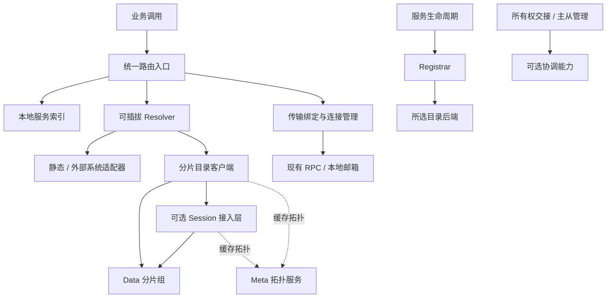

# 统一路由与可插拔目录设计

- 日期：2026-10-30
- 状态：待评审的架构设计草案，尚未批准实施
- 范围：服务发现收敛、逻辑实体寻址、后端解耦、分片扩展，以及与原生 Go 滚动升级的衔接
- 本文不代表现有框架已经实现这些能力，也不承诺未经压测的节点规模或性能指标。

## 1. 设计结论

框架以统一路由作为业务寻址入口，将当前服务发现中的注册、存活管理、查询、订阅和主从协调拆成后端无关的能力契约。

核心不要求 etcd、Redis 或独立路由集群。使用者按环境注入本地、静态、数据库或服务型实现。框架可以提供一个 Go 编写的分层分片路由实现，但不强制所有应用部署它。

统一的是入口、数据模型和行为契约，不是强制所有后端拥有相同的一致性、可用性和扩展能力。

推荐的规模化实现采用三层结构：

1. Session：可选的接入、连接和请求转发层。
2. Data：按 Key 分片管理目录数据，分片组内部复制。
3. Meta：管理目录分片拓扑，不保存每个玩家的位置。

玩家业务位置与目录数据分片相互独立。玩家可以按负载分配到任意业务节点；换场景只更新所属目录分片中的记录，不要求玩家绑定某个固定业务分片。

## 2. 背景与问题

### 2.1 业务约束

- 框架和业务逻辑使用 Go，不依赖脚本热更新。
- 玩家登录时按实时负载和其他条件选择节点，不同登录可能位于不同节点。
- 玩家频繁切换场景，最终目的地址缓存可能频繁失效。
- 需要覆盖普通服务发现、指定服务实例寻址、玩家和房间等逻辑实体寻址。
- 目标是通过增加路由分片扩大容量，而不是把全部数据复制到每个调用方。
- 一些部署环境没有 etcd，不能将其作为框架运行前提。

### 2.2 已描述的业务方案

当前业务使用 Redis 按 Key 分片保存位置，写入时以分布式锁辅助。为降低高频查询压力，又引入 Session 服务：

1. 场景切换写 Redis。
2. 向所有 Session 广播更新。
3. Session 命中缓存直接返回，未命中时回源 Redis。

该结构存在以下潜在问题，尚未通过生产指标确认各项影响程度：

- 更新广播随 Session 数量放大。
- 多份缓存重复占用内存；扩容和重启带来冷启动回源。
- Redis 与其他业务共用容量及故障域，高峰期间容易相互影响。
- Redis 写成功与广播成功之间存在故障窗口。
- 通知丢失、乱序和并发回源可能产生旧值覆盖新值。
- 分布式锁过期不等于旧执行者已经停止，不能单独保证所有权安全。

新增缓存只能改善部分读取，不能消除高频变化数据的传播成本。

### 2.3 当前框架的已核查耦合

以下基于本次讨论期间读取的源码，不是全仓库依赖审计：

| 代码 | 当前职责和耦合 | 收敛方向 |
|---|---|---|
| [IDiscovery](../../engine/pkg/interfaces/IDiscovery.go) | 只有 Init、Start、Close | 以明确的解析、注册等能力替代空泛生命周期抽象 |
| [Cluster](../../engine/pkg/cluster/cluster.go) | 工厂创建发现实现；直接引入 etcd；以发现实例是否存在判断集群模式 | 显式注入路由运行时和部署模式 |
| [发现接口](../../engine/pkg/cluster/discovery/interfaces.go) | 已有后端无关租约句柄，但客户端接口返回 etcd Watch/Get 类型 | 后端类型只存在于适配器内部 |
| [发现工厂](../../engine/pkg/cluster/discovery/registery.go) | 可注册实现，未知名称返回 nil | 配置错误显式失败，不隐式降级 |
| [EndpointManager](../../engine/pkg/cluster/endpoints/endpoints.go) | 消费 etcd 事件及 KeyValue，兼顾注册、远端目录和通信 | 拆分目录同步与通信资源职责 |
| [Router](../../engine/pkg/router/selector.go) | 从本地 Repository 选择服务，返回 IBus | 增加上下文、错误和按需远程解析能力 |
| [Node](../../engine/pkg/node/node.go) | 直接调用 etcd 发现调试配置，另有授权策略的 etcd 可选路径 | 由适配器拥有配置与初始化逻辑 |

现有工厂意味着“可以注册另一实现”，不意味着实现已经与 etcd 协议完全解耦。

## 3. 目标与非目标

### 3.1 目标

- 核心运行不需要 etcd；推荐核心导入链也不直接依赖 etcd SDK。
- 为不同部署规模提供一致的业务寻址入口。
- 对状态、可见性、取消、错误、存活和一致性给出明确契约。
- 支持局部缓存、局部订阅和按需建连，不要求全量目录同步。
- 支持目录分片扩容、迁移、故障恢复和版本化交接。
- 将服务主从协调从具体发现实现中分离。
- 保留本地直投及现有 RPC 传输能力。

### 3.2 非目标

- 不提供任意 Go 函数在同一进程中的安全替换。
- 路由不自动完成业务状态迁移、数据库 schema 兼容或业务事务。
- 不承诺数学意义上的无限容量；单 Key、单分片、网络及协调面仍有上限。
- 不将每次业务 RPC 写入共识日志。
- 不要求所有后端支持主选举、强一致或动态扩容。
- 不直接复刻 SOFARegistry，也不把 DHT 当作规模增长的必经阶段。

## 4. 架构与职责边界



图中 Registrar、Resolver 可以由同一个后端对象实现，但职责和权限应分开。注册不能通过“读取接口”隐式完成。

### 4.1 必须区分的概念

| 概念 | 回答的问题 |
|---|---|
| 解析 Resolver | 目标现在在哪里？ |
| 调度 Placement | 新实体或待迁移实体应该放在哪里？ |
| 所有权协调 | 谁被允许处理该实体的权威写入？ |
| 传输 Transport | 如何连接目标并发送请求？ |
| 状态迁移 | 如何搬移内存状态、排空旧任务、恢复新实例？ |
| 分片拓扑 | 该目录 Key 由哪个目录分片组管理？ |

路由失败不能自动触发“随便选一个节点创建玩家”。这可能制造重复实例。

### 4.2 Session 的定位

Session 不再接收所有玩家位置变化。它负责认证、连接管理、限流、请求复用及按拓扑转发。

“可扩展接入层”不等于完全没有状态：连接、在途请求和短期缓存仍是状态，但不是不可替代的目录权威数据。

内部可信客户端可以直接访问 Data，省去 Session 跳数。Session 不是普通业务 RPC 的强制转发代理。

## 5. 公共数据模型

下面是拟议契约，不是已经确定的 Go API。

### 5.1 Target：逻辑目标

应包含：命名空间或租户、目标种类、逻辑标识，以及必要的结构化约束。

目标种类至少区分：

- ServiceQuery：按服务类型、名称、分区、标签等查询候选。
- Instance：指定服务实例。
- Entity：指定玩家、房间等实体。

不同目标不得共享一个模糊字符串空间，也不能在一种解析失败后无条件切换到另一种解析方式。

### 5.2 InstanceRecord：服务实例

应描述：

- 实例 ID、节点 ID、进程 incarnation（区分重启前后）。
- 服务类型、名称、分区、标签及版本。
- 通信协议与地址。
- Ready、Draining 等生命周期状态。
- 可见性及注册会话归属。
- 实例记录版本。

实例 ID 和现有 PID 的映射需要保持明确；不以 IP 地址充当永久实例身份。

### 5.3 EntityBinding：实体绑定

应描述：实体 Key、目标实例、所有权代次、记录版本，以及必要的交接状态。

建议初期状态模型：Active、Transferring、Absent。Transferring 状态下禁止调度器另建副本；是否等待或快速返回不可用由调用策略决定。

业务快照、背包等大对象不存入路由记录。

### 5.4 Route：解析结果

包含可调用目标及其校验信息：实例身份、地址或传输标识、记录版本、可选的所有权代次、缓存提示。

缓存提示不是安全承诺。记录未超过 TTL 不代表所有权一定没有变化。

服务候选选择只适用于可互换实例；Entity 解析不能从多个候选中随机选择一个所有者。

### 5.5 版本必须分离

| 版本 | 用途 |
|---|---|
| TopologyEpoch | 目录分片归属变化与旧拓扑重定向 |
| RecordVersion | 单记录并发更新、缓存及事件新旧判断 |
| OwnershipEpoch | 隔离旧实体所有者 |
| SubscriptionCursor | 增量订阅续传与缺口检测 |

普通记录版本可以是后端定义的不可解释令牌，仅用于等值条件更新；若需要排序，后端必须明确其比较范围。不得用各机器墙上时间充当统一版本。

实体删除、重建后，旧所有者令牌仍必须失效。可通过持久化代次或新的实体 incarnation 建立隔离，不能将计数器简单归零后复用。

## 6. 能力接口设计

### 6.1 必需和可选能力

| 能力 | 语义 | 要求 |
|---|---|---|
| Resolver | 精确解析及有界候选查询 | 所有后端必需 |
| Registrar | 注册、更新、注销和会话存活 | 动态实例注册时必需 |
| BindingWriter | 带前置条件更新实体绑定 | 动态实体位置管理时必需 |
| Subscriber | 按范围获取快照及增量变化 | 可选 |
| OwnershipCoordinator | 带隔离令牌的所有权交接 | 唯一所有权场景必需 |
| LeaderElector | 服务主从竞争与失去领导权通知 | 主从模式必需 |

协调能力可以共享实现，但实体迁移与服务主选举不宜被压成一个含糊的 Lock 接口。

### 6.2 概念性 Go 接口草图

以下用于说明边界，参数类型应在实施前结合现有 PID、错误体系和生命周期接口定稿；本段不是可直接编译的代码文件。

```go
// 概念性接口；其请求和结果类型见本文数据模型及行为契约。
type Resolver interface {
    Resolve(ctx context.Context, target Target) (Route, error)
    Query(ctx context.Context, query ServiceQuery) (CandidatePage, error)
}

type Registrar interface {
    Register(ctx context.Context, request RegisterRequest) (Registration, error)
    Renew(ctx context.Context, registration Registration) (Registration, error)
    Update(ctx context.Context, request UpdateInstanceRequest) (InstanceRecord, error)
    Unregister(ctx context.Context, registration Registration) error
}

type BindingWriter interface {
    CompareAndSwap(ctx context.Context, request BindingCAS) (EntityBinding, error)
}

type Subscriber interface {
    Subscribe(ctx context.Context, request SubscribeRequest) (Subscription, error)
}
```

契约要求：

- 所有网络操作接受 context，遵守取消及期限。
- 写操作带操作 ID，重试能够查询或返回同一次提交结果。
- Register 返回的会话句柄绑定实例 incarnation，旧会话不能注销新实例。
- Update 必须检查会话及记录版本，不能用旧续租恢复已撤销记录。
- Query 有明确范围、数量上限及分页语义，不默认列出整个集群。
- 比较更新需表达“必须不存在”“必须匹配版本”等前置条件。
- 不支持的能力返回明确错误；初始化时尽可能完成能力校验。
- 实现应声明并发安全、关闭语义、读一致性及持久化保证。

Registrar 可以由运行时统一调度 Renew；原生租约后端可在内部复用长连接，不要求每个实例各建一条心跳流。

### 6.3 错误模型

至少区分：NotFound、Unavailable、DeadlineExceeded、Conflict、StaleRoute、Moved、Unsupported、PermissionDenied、Overloaded、ResyncRequired。

- NotFound 是成功查询后确实不存在，不能用来包装网络故障。
- Moved 用于旧拓扑；返回有认证来源的新拓扑提示，并限制重定向次数。
- Conflict 表示条件更新未满足，不应盲目覆盖。
- 写请求超时可能已经提交；应按操作 ID 查证，而非假定未写入。
- 权威路由数据不全或分片不可用时，不能任意寻找其他业务实例替代。

## 7. 核心流程

### 7.1 启动与服务注册

1. Node 注入路由能力组合，校验必需能力和配置。
2. 启动本地通信端点及本地索引。
3. 注册实例，初始为不可接收新流量的状态。
4. 业务初始化完成后发布 Ready。
5. 续租或维持后端等价存活机制。
6. 关闭时先发布 Draining，再排空任务，最后注销并关闭资源。

路由系统自身需要独立 bootstrap，不能先发现自己才能启动。初期采用配置的种子地址；可以使用 DNS，但 DNS 不等于目录权威数据。种子故障应有多地址重试及恢复流程。

### 7.2 普通服务调用

1. 根据结构化条件得到有界候选。
2. 按本地或后端策略选择符合 Ready、可见性和版本约束的实例。
3. 将 Route 绑定为本地邮箱或远程 Dispatcher。
4. 发送 RPC。

查询缓存可以共享，连接按实际使用创建。选择策略须说明是近似均衡还是精确全局最优；不能通过有限候选暗示全局最优。

### 7.3 玩家精确调用

1. 用实体 Key 解析 EntityBinding。
2. 后端返回目标实例和 OwnershipEpoch，必要时同时解析地址。
3. RPC 携带逻辑目标、所有权代次和请求 ID。
4. 接收方检查自己是否仍有权处理，陈旧请求返回 StaleRoute 或受控重定向。
5. 调用方刷新后在剩余期限内有限重试。

仅比较请求令牌还不够：失联旧节点可能只知道旧代次。安全依赖可验证的所有权有效性、失去租约后停止写入，以及外部写入端的 fencing。仅凭旧节点本地缓存无法解决网络分区双写。

非幂等请求出现“已执行但响应丢失”时，不允许自动当作未执行。需要业务去重或结果查询。

### 7.4 玩家切场景及所有权交接

推荐保守的停写交接流程：

1. 以版本条件进入 Transferring，串行化该实体的迁移。
2. 旧所有者停止接收新权威写入，排空在途任务和异步副作用。
3. 生成快照并传输；目标恢复，但暂不开放权威写入。
4. 协调器提交新的所有者和更高隔离代次。
5. 写入端建立新隔离代次，目标才开始处理权威写入。
6. 完成路由发布，旧进程清理或进入短期拒绝/重定向状态。

步骤之间的崩溃必须由可恢复的迁移操作记录驱动。目录 CAS 不能原子覆盖快照、数据库和业务 RPC；发生不确定性时优先暂停该实体，而不是制造两个可写所有者。

若旧节点不可联系，必须确认旧租约失效并建立写入隔离后再接管。只适用于有相应协调保证的后端。

## 8. 分层分片路由实现

### 8.1 Key 到分片

推荐初期采用预分配虚拟分区及分区到副本组的映射。不要直接使用 `hash(key) % 当前服务器数量`，否则扩容会大范围重映射。

虚拟分区数量是可测量、有限的规划参数；未来若不足，需要受控拆分或更换分区映射，不能声称固定数量提供无限扩展。

实体记录以实体 Key 分区。服务查询需要按服务类型、命名空间等组织索引；一个超大服务类型还需分桶，不能把其全部实例堆在单个索引 Key。

精确查实体通常只访问一个目录分片组；任意跨服务过滤不具有相同成本。

### 8.2 复制与一致性

推荐权威分片采用成熟 Go 共识库承载条件更新及所有权记录；这只是推荐实现，不是核心接口要求。

- 写入由当前分片写入者协调，并明确持久化确认点。
- 允许陈旧读取的服务候选可从副本读取。
- 所有权判定及交接读写要求相应的强一致路径。
- 普通调用可以使用旧路由，但必须有接收和写入侧安全约束。
- 不能把“百万级”直接等同于“只能 AP”。一致性应按操作语义选择。

若每个分片组使用独立共识实例，需要评估组数量、心跳及日志开销；可由一个进程承载多个分区，但不能未经测量假定成本为零。

### 8.3 Meta

Meta 保存分区映射、副本组成员、拓扑代次及迁移状态，不保存玩家位置或每次业务心跳。

Meta 自身可以采用 Go 共识服务，也可以适配外部协调设施；不强制使用 etcd。Meta 不可用时，已有拓扑可继续用于尚有效的分片访问，但禁止无法确认安全性的拓扑改动。

当拓扑本身变大时，可按区域或命名空间分域，只向客户端下发其访问域。初期不引入 DHT，保留拓扑定位器的实现替换空间。

### 8.4 分片迁移

1. 建立目标副本及快照。
2. 按日志追赶增量，检查追赶进度。
3. 通过协调协议暂停旧写入或完成成员变更。
4. 确立新的唯一写入组和更高拓扑代次。
5. 发布新拓扑；旧入口有限期返回 Moved。
6. 确认安全后清理旧数据。

具体采用共识组成员变更还是跨组迁移，应在实现规格中二选一定稿；两者不能混用成“更新一条 Meta 记录即可安全切换”。本文要求任何方案都满足：旧组不能继续成功提交、新组数据不丢失、客户端旧拓扑可收敛。

### 8.5 容量模型

设位置更新速率为 U，Session 数量为 S，副本数为 r，平均每条记录额外订阅者数量为 W。

- 当前全广播投递量约为 U × S。
- 分片组基本复制量为 O(U × r)。
- 存在外部订阅时还需计入 O(U × W)。

因此减少全广播不意味着可以免费给所有调用者推送所有变化。必须限制订阅范围和扇出。

增加分片主要扩展不同 Key 的容量，不能自动解决一个玩家或一个热门服务索引的单 Key 热点。

## 9. 缓存、订阅与高频变化

### 9.1 三种缓存分别管理

- 拓扑缓存：低频变化，可较长保留，通过 Moved 刷新。
- 实例地址缓存：随实例生命周期变化。
- 实体位置缓存：可能高频变化，短期、按需、容量有界。

玩家位置变化不应使整个拓扑缓存失效。

### 9.2 推荐策略

- 同 Key 的并发查询合并，但调用方取消不能错误取消其他等待者。
- 限制缓存容量、回源并发和重试次数。
- 负缓存短期有效，版本化创建通知应能使其失效。
- 不订阅不访问的实体；活跃订阅也必须有配额。
- 本地缓存应用更新时比较有效版本，拒绝旧回源覆盖新事件。
- 高变动实体可以直接查询所属 Data；缓存不是必选项。

查询模式需要一次目录查询后直连业务；转发模式可避免调用方缓存最终位置，但增加数据路径带宽和延迟。初期推荐查询模式，只有在压测证明有收益时才为特定业务引入转发。

### 9.3 订阅可靠性

Subscriber 必须定义：

- 快照和后续增量之间不丢事件的边界。
- 游标的有效范围，以及日志保留窗口。
- 断线续传、重复事件及每 Key 顺序。
- 游标过期时显式返回 ResyncRequired。
- 慢消费者的有界缓冲、断开和重同步策略。

不同分片可以使用独立游标，不应假定全局事件顺序。普通广播不能冒充可靠变更日志。

## 10. 与 Redis 的关系

### 10.1 过渡方式：Redis 仍是权威

Data 是分片管理的物化视图，按范围从 Redis 初始化，并接收可靠增量。

优点是业务写入迁移较小；缺点是正常更新仍消耗 Redis，且必须解决记录写入和变更日志的一致提交。可采用同一事务范围内的日志或 outbox，但不能把“写 Redis 后发送通知”宣称为原子操作。

若没有可靠日志，应采用版本化校对与重建并明确陈旧窗口；不适合依赖零陈旧所有权的场景。

### 10.2 目标方式：Data 是路由权威

所有目录写入提交给所属 Data，正常寻址和位置更新不依赖 Redis。Redis 继续服务其他业务，或仅承载非权威导出。

代价是路由服务必须自己承担复制、恢复、持久化、运维和升级，而非简单把 Redis 替换为 Go map。

### 10.3 迁移权威源

可以影子读取比对，但不得让两个后端同时独立决定所有权。切换需逐范围冻结或协调写入、追赶数据、建立版本边界，再切换唯一写入口。

回滚也要完成反向追赶和权威交接，不能直接切回旧快照。

## 11. 当前框架的改造边界

### 11.1 Node 与 Cluster

- 显式注入路由运行时，每个 Node 拥有自己的运行时实例。
- 全局工厂如保留，只存构造函数，不保存可变连接或业务状态。
- 核心不直接引入 etcd 适配器，由应用装配。
- 显式本地模式、静态模式、动态模式；未知配置启动失败。
- 集群模式不再简单等价于 discovery 非 nil。
- 生命周期统一管理关闭次序、超时和错误传播。

### 11.2 EndpointManager 与 Repository

- 本地服务索引保留状态、可见性和本地邮箱语义。
- 远端记录改成缓存/查询结果，不再暗示全局全集。
- 通信资源与目录缓存分别设限：缓存记录不等于建立连接。
- etcd KeyValue 解析和事件类型留在适配器内。
- 启动、Ready、下线和可见性变化转换为中立注册操作。
- node 可见的服务不向其他节点暴露，但其主从协调需求可以独立存在。

### 11.3 现有 Router 方法的兼容

现有方法只返回 IBus 或 nil，无法充分表达网络查询错误。建议新增带 context 和 error 的解析入口，再逐步迁移调用链。

旧接口只在明确的兼容范围内保留，不能内部无限等待远程解析，也不能把所有错误变成未找到。

指定 PID 若包含直接传输信息，可以提供明确的直连模式，但不得借此绕过实体所有权验证和权限检查。

### 11.4 任意 Go 过滤函数

现有 [SelectByRule / SelectByFilterAndChoice](../../engine/pkg/router/selector.go) 接受 Go 函数。这类函数不能直接跨进程执行。

推荐：

1. 远端查询使用结构化条件和有界结果。
2. 自定义 Go 函数只能在显式候选范围内执行。
3. 必须依赖全量集合的旧语义只留在本地/兼容模式，规模化模式明确拒绝。
4. 管理端全量遍历使用分页、限流及专门接口，不成为每次 RPC 的路径。

### 11.5 etcd 的两种解耦目标

- 运行解耦：不部署 etcd 也能工作。
- 依赖解耦：核心构建的导入链不包含 etcd SDK。

推荐最终同时实现。适配器可放独立 Go module，使核心 go.mod 也无需声明 etcd；如果仍在同一 module，运行虽可不依赖 etcd，依赖清单仍可能保留 SDK。

[Node](../../engine/pkg/node/node.go) 中授权策略的 etcd 路径需一并隔离，但其策略语义不因此改为路由数据。实施前应搜索完整导入链，本文不宣称已经列出所有 etcd 使用点。

## 12. 原生 Go 升级的衔接

推荐稳定入口加 V1/V2 业务进程共存，路由目录提供实例版本及实体所有权交接。

- 无状态服务：V2 Ready 后逐步接新流量，V1 Draining。
- 有状态实体：自然排空，或按第 7 节执行主动迁移。
- DeploymentVersion、OwnershipEpoch、TopologyEpoch 是不同概念。
- V2 已产生新业务写入后，不能将 V1 旧快照直接恢复为权威。
- 状态格式及协议必须支持升级期间的兼容窗口。

路由提供切换位置，不等于已经实现热升级全部流程。

## 13. 故障策略

| 情况 | 预期行为 |
|---|---|
| 接入 Session 宕机 | 重连其他入口；按操作 ID 查证不确定写入 |
| Data 读副本滞后 | 按读一致性契约处理，不能假冒最新所有权 |
| 权威分片失去多数派 | 拒绝需强一致的写入/所有权变更；不绕过仲裁 |
| Meta 暂时不可用 | 使用有效旧拓扑访问现有分片，暂停拓扑变更 |
| 业务节点宕机 | 标记不可达/等待存活机制确认；恢复由调度和状态恢复负责 |
| 通知丢失或游标过期 | 续传或快照重同步，不无限相信缓存 |
| 写超时 | 结果可能未知，按操作 ID 查询或幂等重试 |
| 热 Key | 限流、排队、合并读取；不能靠增加其他分片解决 |
| 目录过载 | 明确 Overloaded、退避、请求预算，禁止无限回源 |
| 网络分区的旧所有者 | 停止权威写入并由写入侧隔离；不只依赖缓存失效 |

## 14. 安全与可观测性

### 14.1 安全边界

- 身份认证与租户/命名空间授权。
- 实例只能更新自己有效注册会话拥有的记录。
- 实体所有权变更需要专门权限，不等同于普通查询权限。
- 限制客户端提供的地址和重定向目标，防止未授权访问内部地址。
- 控制查询、订阅、连接及写入配额。
- 控制面通信加密；日志不输出凭据和完整敏感业务状态。

### 14.2 指标

- Resolve/Query 的吞吐、P50/P95/P99、错误分类。
- 本地命中率、回源率、请求合并收益。
- 每分片记录量、读写负载、日志大小、复制延迟。
- 每次更新的通知扇出、订阅数、慢消费者及重同步次数。
- 注册续租失败、失去领导权、所有权冲突、陈旧路由拒绝。
- 连接数量、创建速率、空闲回收率。
- Meta 请求量、拓扑缓存命中及 Moved 次数。
- 迁移时长、停写窗口、失败恢复和隔离拒绝数量。

不要将玩家 ID 直接作为指标标签，以免高基数拖垮监控系统。

## 15. 验证与验收

### 15.1 适配器契约测试

所有实现根据声明能力运行同一套测试：取消、超时、错误分类、并发安全、生命周期、注册会话隔离、条件写冲突、幂等操作及缓存版本处理。

不支持的能力必须稳定拒绝，而不是在某些路径静默成功。

### 15.2 故障与一致性测试

- 并发登录、并发迁移、重复请求及响应丢失。
- 旧所有者失联但继续执行任务，外部存储拒绝旧令牌。
- 删除后重建，旧注册会话和旧实体代次均不能复活。
- 快照与订阅交界处更新、通知乱序、断线续传和日志压缩。
- 分片迁移每个阶段进程崩溃，验证唯一写入者及记录完整性。
- 共识成员变化和网络分区，不以可用性换取双写。
- 大量 Session 同时启动，回源和重连保持有界。

### 15.3 框架回归

验证本地调用、跨节点 RPC、Ready/Draining、可见性、主从选举、多个 Node 隔离、关闭顺序及既有传输协议。

至少提供一个无需 etcd 的真实双节点运行样例，并验证未启动 etcd 时仍可注册、寻址、调用和下线。

### 15.4 容量验收方式

压测必须分别记录业务实例数、实体记录数、路由进程数、查询 QPS、更新 QPS、连接数、订阅扇出和记录大小。

按固定负载模型逐步增加 Data 分片，测量吞吐增长、尾延迟、资源曲线和 Meta 压力；不能只报告“支持百万节点”。具体数值由实际业务基线和硬件预算确定，本文不虚构目标值。

## 16. 分阶段演进建议

| 阶段 | 交付内容 | 退出条件 |
|---|---|---|
| A：契约与解耦 | 中立模型、能力接口、错误语义、Node 注入 | 核心不需要运行 etcd，状态/可见性语义保持 |
| B：最小可用实现 | 本地及静态适配器，现有 etcd 隔离为兼容插件 | 无 etcd 双节点样例与契约测试通过 |
| C：按需解析 | 新 Router 入口、有界缓存、按需连接、结构化查询 | 不要求每个节点拥有全量目录 |
| D：分片目录 | Session/Data/Meta、复制、恢复、可靠订阅 | 故障和扩容验收通过 |
| E：实体协调 | 玩家绑定、版本隔离、状态迁移协议 | 重复登录和分区情况下无权威双写 |
| F：升级流程 | V1/V2 共存、排空、迁移及受控回退 | 业务状态及协议兼容测试通过 |

这是建议的演进顺序，不是已批准的实施计划。不要为构建最小路由抽象立即实现完整分布式注册中心。

## 17. 方案取舍与待评审决策

### 17.1 已形成的推荐方向

- 统一业务寻址入口，内部按能力拆分。
- 核心不强制 etcd，也不强制自建分片路由集群。
- 大规模实现采用分层分片目录，避免全局玩家更新广播。
- 玩家动态业务分配与目录分区独立。
- 精确所有权协调不因普通服务发现允许最终一致而弱化。
- 初期采用查询后直连，不强制所有业务 RPC 经路由转发。

### 17.2 需要用户评审后决定的事项

1. 首期仅完成接口解耦，还是同时交付生产级分片路由服务？推荐先解耦。
2. 是否要求核心 go.mod 完全不含 etcd？推荐通过独立适配器 module 达成。
3. 旧选择器兼容多久？推荐限定兼容范围并显式废弃全量任意过滤语义。
4. Redis 是过渡权威源，还是直接迁移到独立 Data？取决于业务迁移窗口及可靠增量条件。
5. 哪些实体必须拥有强所有权保证，哪些只是允许短时陈旧的位置索引？需按业务分类。
6. Meta 和 Data 的持久化、共识库及跨故障域策略，需要运维约束和恢复目标后再选型。
7. 峰值查询/更新、实体数、实例数、可接受停写时间和恢复目标，需要生产测量后确定。

这些是显式待决策项，不应由接口默认值悄悄决定。

## 18. 参考与证据边界

- [SOFARegistry 官方仓库](https://github.com/sofastack/sofa-registry)：分层、水平扩展注册体系的参考；不代表本文照搬其一致性或实现语言。
- [BitTorrent BEP 5](https://www.bittorrent.org/beps/bep_0005.html)：DHT 定位的比较资料；DHT 节点数与目录管理实体数不是同一个指标。
- 前文提到的其他系统规模与吞吐数字未作为本文容量承诺。

本文是供评审的设计文档；没有修改运行时代码，没有选择具体共识库，也没有实施或验证分布式协议。
